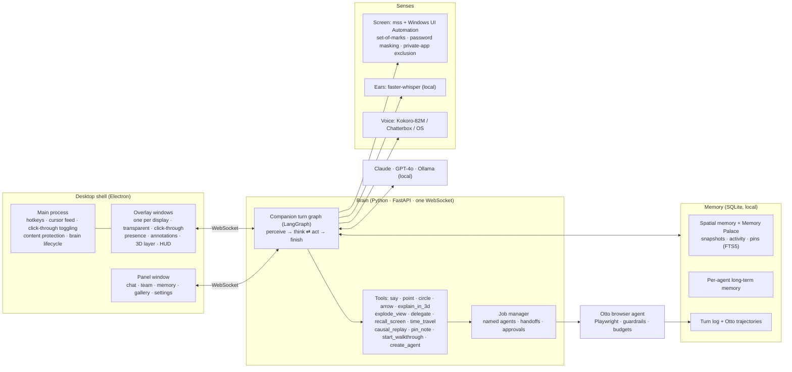
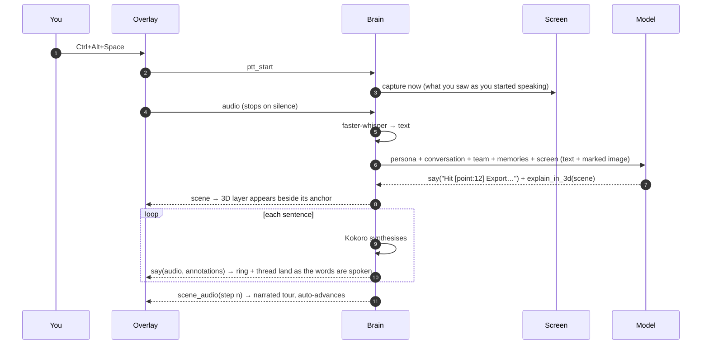

<div align="center">

# Pyxi

**A little firefly on your desktop that sees your screen, talks with you, points at things, does the clicking when you let it, sends agents off to do real work, and explains in 3D.**

Electron · React Three Fiber · Python · LangGraph · Playwright (via [Otto](https://github.com/marzukchowdhury/otto)) · faster-whisper · Kokoro-82M · Claude or a local model


</div>

---

Pyxi is an attempt at a new interface paradigm, not an assistant bolted onto the desktop. A little firefly lives beside your cursor and a slim glass notch sits on the top edge of your screen. Hold <kbd>Ctrl</kbd>+<kbd>Alt</kbd> and just talk about anything on screen. Pyxi looks (screenshot plus the accessibility tree), answers in a natural voice with a sense of humour, and *shows* rather than tells. It writes field notes beside the paragraph it's explaining, rings the button you need, walks you through an app one real click at a time, builds animated 3D models of real things, and runs errands in your connected accounts, asking before anything leaves your PC.

For real work, Pyxi delegates to named teammates. Scout drives a real browser, Quill writes, Sketch builds 3D scenes, and they hand work to each other while you watch. Afterwards any browser job can be replayed as a **Ghost Walkthrough** that teaches you how to do it yourself. And because Pyxi can keep a **Memory Palace** of what was on your screen (opt-in), you can say *"take me back to the pricing page this morning"* or *"how did I get here?"* and explore the answer in 3D.

## What makes it different

| | |
|---|---|
| **3D explanation layer** | The model writes a typed **Scene spec** (nodes, edges, layouts, narrated steps), never code. A React Three Fiber renderer turns it into dark-glass objects with luminous rims, flowing particles and a camera that tours each step while Pyxi narrates. |
| **Exploded views of the real UI** | "What is all this?" peels the actual panel apart: every element is cropped from the screen and placed *exactly* over its real pixels, then lifted into depth by hierarchy. |
| **Memory Palace and time travel** | An opt-in spatial history of your screen (windows, focus changes, element positions). "Take me back to…" rebuilds a past interface as an explorable hologram with a time scrubber. |
| **Causal explanation mode** | "How did I get here?" turns your recent activity into a 3D chain of events with *led to* threads and dashed *what if* branches. |
| **Persistent named agents** | Teammates with personas, voices, their own long-term memory and real capabilities. Handoffs are first-class: Scout researches, then Quill writes from Scout's result. |
| **Ghost Walkthroughs** | Every browser job records what was clicked and why, so it can be replayed as a tutorial with a ghost pointer and spotlight on each element. |
| **3D models of real things** | For "how does a jet engine work?" the model assembles a real-looking object from parts (cylinders, gears, springs, tubes, extrusions) with materials, callouts and narrated beats that animate like a short video. Follow-ups such as "show the inside" or "make it spin" edit the same model. |
| **Field notes on screen** | "Explain this meme / chart / page" writes a notebook card beside the content. Each point writes itself in ink as Pyxi says it, frames the exact thing it means with a numbered hand-drawn outline, and a thread links the two. Freehand sketches draw trends on real charts. The card is placed wherever it covers the least text. |
| **Guides that wait for you** | "How do I add an environment variable in Vercel?" marks the one control to click with an arrow from your cursor, waits for your real click, looks again, and gives the next step until you're done. Name the app ("...in Notepad") and Pyxi looks at that window, even on your other monitor. |
| **Hands, when you allow it** | "Play Blinding Lights on YouTube Music", "make a pivot table of this in Sheets": Pyxi asks first (an Allow card, or Always allow), then moves your real mouse and keyboard, labels what it's doing beside the cursor, and hands control back the moment you move the mouse or press <kbd>Esc</kbd>. Sending, buying, deleting and closing things always ask again. |
| **Bookings that stop at the till** | "Book me a dental cleaning Saturday morning", "two tickets for tonight, good seats", "a table for four at 7": Scout finds the slot in a browser you can watch, fills the form from details you saved once (kept on your PC), asks you before the final booking click, and never pays. At the payment page it hands you the window ("Pay here, then press Done") and then reads back the confirmation, with an Add to calendar button. Practice sites (`python -m pyxi.demo_bookings`) let it rehearse without booking anything real. |
| **Desktop chores** | "Play Billie Jean, a bit quieter" starts the song in a window behind yours in seconds, no clicking, and sets the volume. Lay out two, three or four windows in one go ("Facebook, Stake and Gmail side by side"), tidy a messy Desktop into folders (you approve the plan, nothing is deleted, and "undo that" puts it all back), pause or skip music, and find "coffee near me, open now" on Google Maps. |
| **Pictures explained on the picture** | "Explain this diagram" pins short tags onto the actual parts of the picture and traces the flows across it, instead of opening a separate diagram. |
| **The notch** | Hold <kbd>Ctrl</kbd>+<kbd>Alt</kbd> to talk; it shows Listening, then "Looking at Chrome", then streams Pyxi's words. Hover it for a small chat; double-tap <kbd>Ctrl</kbd> to type. Errors (mic blocked, no key) show up here instead of failing silently. |
| **A voice studio** | Pick who Pyxi sounds like: free on-device Kokoro voices (and Mitali, who speaks Bengali), or ElevenLabs and Gemini voices with your own key. Each voice has a drawn signature and an in-character preview; speed, language and captions are one tap away. Sentences can carry a tone that premium voices perform. |
| **Connected accounts** | Gmail, Google Calendar, Google Docs, Discord and LinkedIn. "Sam emailed my recommendation letter, fix it" finds the email, saves the attachment, has Quill fix it into a copy beside the original, and offers to reply with it. Anything that reaches other people waits for an approval card. See [docs/CONNECT.md](docs/CONNECT.md). |
| **Quick actions** | Opens sites and apps, copies exact text, or drops a drafted reply straight into the box you're typing in. |
| **Routines** | "Every weekday at 9, check my email for anything from my professor and tell me." Routines run while Pyxi is open, as ordinary turns inside your daily budget, and you can see or delete them in Settings. |
| **Local-first** | Whisper and Kokoro run on your machine. Local mode uses Ollama, so nothing leaves the computer and it costs $0. |

<p>


</p>
<p>


</p>
<p>


</p>

## Install

**For beta users:** run `Pyxi-Setup-<version>.exe` (one click, no admin rights). Windows may warn about an unknown publisher during the beta: choose **More info → Run anyway**. Open Pyxi, go to **Settings → Join the Pyxi beta**, and type your invite code. No API key needed. The voice downloads by itself on first launch.

**To build the installer:** `python scripts/build_installer.py` (a private Python with the brain inside, then electron-builder) writes `desktop/dist/Pyxi-Setup-<version>.exe`. The beta server lives in [`cloud/`](cloud/README.md).

## Quickstart (from source)

Pyxi targets **Windows 10/11** (the accessibility layer uses Windows UI Automation). You need Python 3.11+, Node 20+, and Chromium for the browser agents.

```bash
git clone https://github.com/marzukchowdhury/pyxi.git
cd pyxi
python -m venv .venv
```

Activate it (`.venv\Scripts\activate`), then install Pyxi. This also installs Otto, the browser-agent engine:

```bash
pip install -e ".[dev]"
```

```bash
playwright install chromium
```

```bash
pyxi setup-voice
```

That downloads Kokoro-82M (about 350 MB) for local speech. Then install and start the desktop app, which starts the brain for you:

```bash
cd desktop && npm install && npm run dev
```

**No API key? It still works.** Without a key Pyxi runs in demo mode, with a scripted brain that knows a handful of requests ("How does HTTPS work?", "Explode this panel", "Where's the export button?", "Have Scout fill in the demo form", "Show me how you did it"). Everything downstream (voice, pointing, 3D scenes, agents, walkthroughs) is the real system.

**Best quality:** put `ANTHROPIC_API_KEY=...` in `.env` (Claude Opus 5.5 by default).

**Through OpenRouter:** one key for Claude, Gemini, GPT and more, with exact per-request costs in the panel. In `.env`:

```
OPENROUTER_API_KEY=sk-or-...
PYXI_MODEL=anthropic/claude-haiku-5.5
PYXI_JOB_MODEL=anthropic/claude-sonnet-5.5
```

Set a credit limit on the key in OpenRouter's dashboard for a hard spending cap.

**Fully local:** pull a vision model and start the brain in local mode.

```bash
ollama pull qwen2.5vl:7b
```

```bash
pyxi serve --local
```

`pyxi doctor` checks keys, voice models, CUDA and Ollama.

### Using it

| Hotkey | |
|---|---|
| Hold <kbd>Ctrl</kbd>+<kbd>Alt</kbd> | Talk while you hold, send when you let go (left <kbd>Alt</kbd> only, so AltGr typing never triggers it) |
| <kbd>Ctrl</kbd>, <kbd>Ctrl</kbd> | Double-tap to type to Pyxi in the notch |
| <kbd>Ctrl</kbd>+<kbd>Alt</kbd>+<kbd>Space</kbd> | Talk, press to start and stop (falls back to another combination if an app already owns it) |
| <kbd>Ctrl</kbd>+<kbd>Alt</kbd>+<kbd>W</kbd> | Show or hide the panel |
| <kbd>Ctrl</kbd>+<kbd>Alt</kbd>+<kbd>Backspace</kbd> | Dismiss drawings and scenes |
| <kbd>Ctrl</kbd>+<kbd>Alt</kbd>+<kbd>P</kbd> | Pause screen sharing |

Things to try: *"Explain this meme"* · *"What's the story in this chart? Draw it."* · *"How does a jet engine work? Show me in 3D."* then *"show me the inside"* · *"Walk me through turning on notifications"* · *"Write a funny reply in this box"* · *"What does this setting do?"* · *"Explode this panel"* · *"How does OAuth work? Show me."* · *"Scout, find the pricing for linear.app, then Quill, write me a two-line summary"* · *"Show me how you did it"* · *"Take me back to what I was doing 20 minutes ago"* · *"How did I get here?"* · *"Make me a teammate called Pixel who compares prices across three shops"* · *"Play Blinding Lights on YouTube Music"* · *"Split the screen: Google Sheets on the right"* · *"My desktop is a mess, organise it"* · *"Find coffee near me that's open now"* · *"Explain this diagram"*.

<p>


</p>
<p>


</p>

## Architecture



### One turn



### Key decisions and trade-offs

**Electron over Tauri.** A transparent, always-on-top, click-through overlay that catches the mouse only over interactive bits (`setIgnoreMouseEvents(true, { forward: true })`, toggled on hover) is mature in Electron on Windows. Tauri is lighter, but its transparent click-through story is rougher, and the overlay is the product. Overlay windows are excluded from screen capture (`setContentProtection`), so Pyxi never sees its own drawings.

**A Scene spec, not generated Three.js.** Letting the model write WebGL code would be flexible but unsafe (you'd be executing model output) and unreliable. Instead it fills a typed schema: nodes with shapes (box, sphere, server, database, user, cloud, card, screen…), edges (flow, arrow, link, dashed), a layout (flow, tree, orbit, stack, grid, timeline, exploded, free) and narrated steps. Invalid parts are repaired rather than rejected. Layout engines, materials, motion and narration timing live in the renderer, so every scene looks designed even when the model is terse.

**Pixel-exact exploded views.** The camera is placed so the z = 0 plane maps 1:1 onto the overlay's pixels. Exploded pieces start flat on their real screen rectangles and lift by depth, so the real interface appears to come apart.

**Structure plus pixels.** The screenshot tells the model what things look like. The Windows UI Automation tree tells it what they are and *exactly* where. Elements get numbered marks on the screenshot (set-of-marks), and the model points by id, which keeps drawings precise.

**Speech-synced drawing.** The model writes markers like `[point:12]` inside its sentence. Speech is synthesised sentence by sentence (first audio in about half a second) and each drawing fires when its sentence starts playing, so Pyxi points as it says "here". This idea comes from [Clicky](https://github.com/farzaa/clicky) (MIT).

**Otto as the hands.** Browser work runs on [Otto](https://github.com/marzukchowdhury/otto), a separate browser-agent engine with its own planning loop, guardrails, budgets and trajectories. Pyxi adds personas, memory, handoffs and walkthroughs on top. Otto records the element each action touched, plus a clean screenshot per step, which is what makes Ghost Walkthroughs possible.

**Local voice.** Kokoro-82M runs faster than real time on CPU (about 0.35× real-time factor here), so it's the default. Chatterbox Turbo is an optional GPU provider for zero-shot voice cloning and tags like `[laugh]`. Kokoro doesn't clone, so the two are complementary. StyleTTS2 was considered and skipped: it's research code with fragile dependencies. If a voice can't load, Pyxi falls back to the OS voice rather than going silent.

**Bengali.** Kokoro has no Bengali and Windows has no Bengali voice, so Bengali has its own path, chosen by measuring the options on real Bengali speech (`samples/bengali/`). Listening: stock Whisper models loop or mishear Bengali (small 168% character errors, large-v3 35%), so Bengali speech goes to Gemini 3.1 Flash-Lite through OpenRouter (14%, about $0.001 a minute, through the beta server in the beta), with a Bengali fine-tuned Whisper on the PC for offline use (`pyxi setup-voice --bengali`). In Automatic, Whisper first decides whether you spoke English, which it does reliably, so English stays local. Speaking: Mitali, a VITS voice trained on Bangladeshi speech (Apache 2.0), runs on ONNX Runtime, downloads once (108 MB) and reads anything written in Bengali script, whoever says it. OpenAI's audio models were rejected because they mispronounce common words (বৃহস্পতিবার is heard as "the 25th").

## Design language

*Quiet luxury and precision.* Near-black glass, hairline borders, ice blue for what Pyxi draws and firefly gold for Pyxi itself, Inter with tight tracking, and fast spring motion (about 220 to 550 ms).

- **A firefly, not a mascot.** A tiny dark-bodied firefly with a glowing tail rides beside the cursor, so it reads on white pages and dark ones. It hovers when you're still and leaves a dotted trail of light when you move; the glow swells with your voice, flickers with a circling mote while it thinks, and its wings buzz inside a turning ring while it talks or works.
- **Targeting is light.** A soft expanding ring at the target and a thin luminous thread from the firefly, recomputed every frame. Every glow has a hairline dark edge, so it survives on light interfaces as well as dark.
- **Explanations emerge.** The explanation surface is a glass plate whose top dissolves into the desktop. 3D content rises above its edge, a tether of light runs back to the element being explained, and the plate grows out of that element.
- **A team with faces.** Each teammate has its own colour and mark (a compass for Scout, a feather for Quill, a cube for Sketch) and shows whether it's free or what it's working on.
- **No emoji, no clutter.** One icon set (1.5 px strokes) and precise geometry.

## Safety and privacy

The full policy is in [docs/PRIVACY.md](docs/PRIVACY.md).

| | |
|---|---|
| **Seeing** | The screen is captured when you talk to Pyxi. The Memory Palace is **off by default**; when you turn it on it records window titles, focus changes and element positions (no keystrokes), and screenshots only if you also allow that. |
| **Private apps** | Password managers, banking and credential dialogs (configurable regexes) are never captured or recorded. Password fields are masked in every image and never stored. |
| **Control** | <kbd>Ctrl</kbd>+<kbd>Alt</kbd>+<kbd>P</kbd> pauses all screen access, with a visible indicator. "Forget everything" wipes the palace. Retention defaults to 72 hours. |
| **Acting** | Pyxi only uses your mouse and keyboard after you press Allow (once, or Always allow). Moving the mouse or pressing <kbd>Esc</kbd> stops it instantly. Sending, paying, deleting, posting, signing in or out and closing tabs or apps always ask again, password fields are never typed into, and every task has a step and cost limit. Browser teammates work in their own browser under Otto's guardrails, with domain rules, no password or card fields, and on-screen approval for anything irreversible. |
| **Local connections** | The brain listens on 127.0.0.1 only, and only Pyxi's own windows (and local tools) may connect: any other web page that tries to reach it is refused, so a site in your browser can't read what Pyxi sees or press its Allow buttons. |
| **Content** | Screen text is treated as data. The prompt tells the model to ignore instructions it finds on screen. |
| **Cost** | Per-turn and daily budgets across turns and agent jobs, shown in the panel. Local mode costs nothing. |
| **Storage** | Everything (palace, turns, trajectories, memories) stays in `.pyxi/` on your machine. |

## Observability

Every turn is logged with what Pyxi saw (the marked screenshot and the accessibility-tree text), the tools it called, what it said, tokens, cost and latency. Agent jobs keep Otto's full trajectories (screenshots, actions, outcomes), which `otto runs report <id>` renders as an HTML replay. `GET /api/turns`, `/api/timeline` and `/api/activity` expose the same data.

## Project layout

```
src/pyxi/
  companion/   brain.py (LangGraph turn loop) · tools.py · prompts.py · annotations.py · notes.py · operator.py (hands) · aim.py · turns.py
  screen/      context.py (capture, marks, masking) · uia.py (Windows UI Automation)
  scenes/      spec.py (Scene schema + repair) · explode.py · gallery.py
  palace/      activity.py · tracker.py · scenes.py (time travel, causal) · when.py
  agents/      registry.py (named agents) · jobs.py (Otto jobs, handoffs)
  memory/      spatial.py (snapshots, FTS5 recall)
  voice/       stt.py (faster-whisper, cloud Bengali listening) · tts.py (Kokoro, Chatterbox, fallback) · bengali.py (Mitali, Bengali numbers)
  hands.py (real mouse and keyboard) · windows.py (snap, split, focus) · tidy.py (folders, with undo)
  walkthrough.py · demo.py · hub.py · server.py · cli.py
desktop/
  src/main/          Electron: windows, hotkeys, cursor, click-through, brain lifecycle
  src/preload/       the bridge (a small explicit API)
  src/renderer/src/
    overlay/         Presence · Annotations · ScenePanel · Walkthrough · Team HUD · Requests
    scene/           SceneView (R3F) · layout.ts (pure, unit-tested) · themes
    panel/           Chat · Team · Memory · Gallery · Settings
  e2e/smoke.mjs      launches the real Electron app and checks both windows
scripts/             capture_readme.py (every README screenshot, staged, no personal data) · scenarios.py (replays everyday requests on recorded screens against the real model) · hands_check.py (one live desktop task)
tests/               brain, scenes, screen, voice, palace, agents, server (pytest)
```

## Testing

```bash
pytest
```

105 backend tests, all offline (a fake screen, scripted brains, pretend hands, the OS voice). One drives a real Chromium: Scout fills a three-page form, Quill writes it up from Scout's result, and the Ghost Walkthrough is built with exact click targets. Another plays the whole recommendation-letter errand against fake Google APIs: find the email, save the attachment, fix the Word file with its styles intact, draft a threaded reply, and send only after Allow.

```bash
cd desktop && npm test && npm run typecheck
```

20 renderer tests cover layouts, the panel's scoped styles and the 3D motion maths (keyframes, looping machinery, piston and crank staying in step).

`python scripts/scenarios.py 1` replays 16 everyday requests (explain this, 3D, research, errands, play a song, a Vercel guide, tidy my desktop, coffee nearby...) on recorded screens through the real model and checks Pyxi's behaviour, for about $0.05.

`node e2e/smoke.mjs` launches the real Electron app and checks the panel and every overlay come up healthy.

## Limitations and roadmap

- **Windows first.** UI Automation, DPI handling and the overlay are built for Windows. macOS would need an AX-tree reader (and could reuse Clicky's ScreenCaptureKit approach).
- **Desktop control is careful, not fast.** Pyxi drives your mouse and keyboard one look at a time (a simple task takes 20 to 60 seconds) and stops after five looks with nothing changing. Desktop Excel needs a license, so spreadsheet work is tested in Google Sheets.
- **Real blur.** Electron can't blur other apps behind a transparent overlay, so glass surfaces use a dense tint. The panel uses Windows acrylic.
- **The taskbar strip.** Windows clamps the overlay to the work area, so Pyxi can't draw over the taskbar.
- **Verified live** on Claude Haiku 5.5 through OpenRouter (about $0.002 to $0.004 per turn): field notes on a meme and a chart, two 3D models built from scratch plus a follow-up edit, click-by-click guides (Notepad, a Google Docs table of contents), typing in Notepad, a song from the YouTube Music app, a Sheets table with SUM and a pivot table, a Docs heading and bullets, a CapCut tour, splitting the screen, tidying a real Desktop with undo, coffee nearby on Maps, inserting a reply, memory, and push-to-talk. **Not yet verified live:** the connectors against real accounts (they're tested end to end against fake Google APIs), ElevenLabs and Gemini voices (no keys here), a local Ollama vision model, and Chatterbox on a GPU.
- **3D models are explanations, not engineering drawings.** A small model builds recognisable objects from primitives; bigger models build richer ones.
- **LinkedIn** only allows apps to post; reading your feed or messages goes through a browser agent you can watch.
- **Next:** streaming speech-to-text and macOS.

## Credits

- [Clicky](https://github.com/farzaa/clicky) by Farza (MIT): the overlay-plus-panel structure and speech-synced pointing.
- [Kokoro-82M](https://huggingface.co/hexgrad/Kokoro-82M) via [kokoro-onnx](https://github.com/thewh1teagle/kokoro-onnx).
- [faster-whisper](https://github.com/SYSTRAN/faster-whisper).
- [React Three Fiber](https://github.com/pmndrs/react-three-fiber) and [drei](https://github.com/pmndrs/drei).
- Discord and LinkedIn marks from [Font Awesome Free](https://fontawesome.com/license/free) (icons CC BY 4.0). Brand logos belong to their owners and are shown only to label each connection.
- [Caveat](https://fonts.google.com/specimen/Caveat) (SIL Open Font License) for the handwritten notes.

## License

MIT. See [LICENSE](LICENSE).
